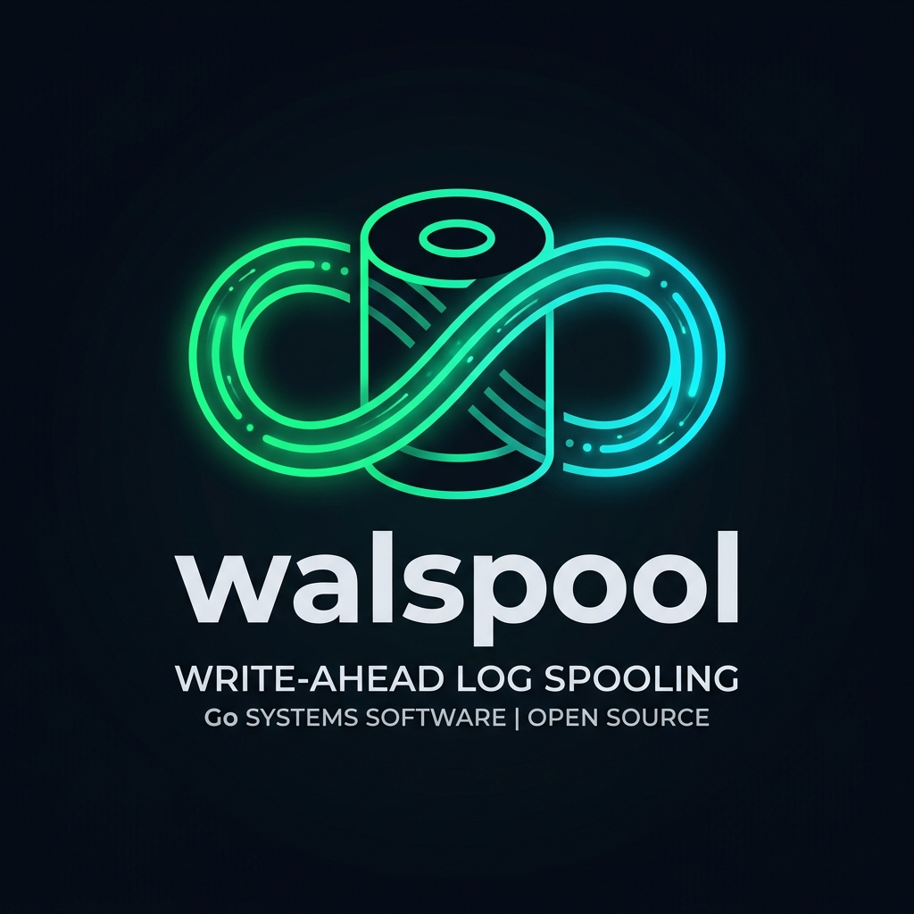
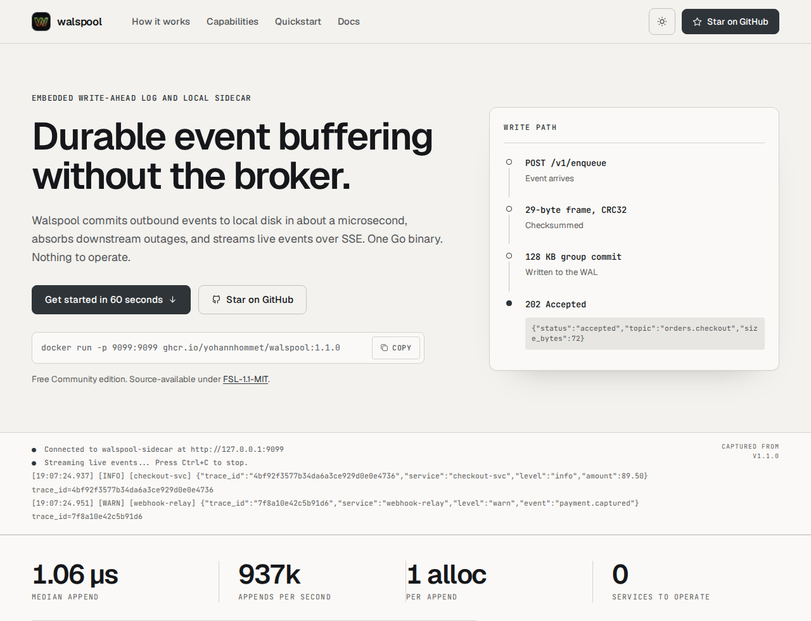

<p align="center">
  
</p>

<h1 align="center">Walspool</h1>

<p align="center">
  <strong>Durable event buffering without the broker.</strong><br>
  Embedded write-ahead log (WAL) library &amp; local sidecar daemon in Go.<br>
  <em>Maintained by <a href="https://github.com/YohannHommet">Yohann Hommet</a> · Supported by <a href="https://meowlabs.tech">Meow Labs</a></em>
</p>

<p align="center">
  <a href="https://golang.org"></a>
  <a href="https://goreportcard.com/report/github.com/YohannHommet/walspool"></a>
  <a href="https://github.com/YohannHommet/walspool/releases/tag/v1.1.0"></a>
  <a href="https://github.com/YohannHommet/walspool/pkgs/container/walspool"></a>
  <a href="LICENSE"></a>
</p>

<p align="center">
  <a href="https://yohannhommet.github.io/walspool/">
    
  </a>
</p>

> [!NOTE]
> **Walspool Community** is free for production and commercial use under the [Functional Source License (FSL-1.1-MIT)](LICENSE), which automatically converts to the permissive MIT License two years after each release.  
> Need enterprise support, custom sinks, or help with a high-throughput deployment? **[Meow Labs](https://meowlabs.tech)** builds with Walspool.

Walspool commits outbound events to local disk in about a microsecond (`1.06 µs` median append), absorbs downstream outages, and streams live events over Server-Sent Events (SSE). Embed the stdlib-only Go core directly inside your process, or run the sidecar next to Node.js, Python, Ruby, Rust, or PHP services. The sidecar adds only the OpenTelemetry protobuf definitions required by its OTLP adapter.

---

## Why Events Disappear

Backend services constantly emit out-of-band events: audit logs, telemetry batches, and partner webhooks. Teams usually pick between three trade-offs:

| Approach | Latency | Crash Durability (`SIGKILL` / OOM) | Operational Footprint | Downstream Outage Behavior |
| :--- | :--- | :--- | :--- | :--- |
| **Synchronous HTTP** | 400ms - 5,000ms | Blocked in flight | Zero infra (high worker count) | Worker pool exhaustion, HTTP 504 timeouts |
| **In-Memory Queue** | < 10 µs | **Total loss on pod eviction** | Low (until memory spikes) | Memory growth, OOM kills |
| **Distributed Broker** | 5ms - 25ms | High (replicated log) | Heavy (cluster, partitions, ops) | Queued in broker (extra infrastructure) |
| **Walspool** | **1.06 µs append** | **NVMe WAL + CRC32 framing** | **1 static binary, 0 ops** | **Bounded local spool, backoff retry** |

Walspool writes each event to a local write-ahead log before returning. The spool is bounded by record count and byte quota, every frame is checksummed with IEEE CRC32, and a crash costs at most the writes in flight.

---

## How It Works

Walspool runs a **Dual-Engine** behind clean [Ports & Adapters](docs/architecture/ARCHITECTURE.md) boundaries:

```
             Incoming Event (Go API, POST /v1/enqueue, or POST /v1/logs OTLP)
                                         │
            ┌────────────────────────────┴────────────────────────────┐
            ▼                                                         ▼
┌───────────────────────────────────────┐ ┌───────────────────────────────────────┐
│         ENGINE 1: DISK WAL            │ │         ENGINE 2: MEMORY HUB          │
├───────────────────────────────────────┤ ├───────────────────────────────────────┤
│ • 29-byte binary frame + CRC32 check  │ │ • Bounded 50,000-record ring buffer   │
│ • 128 KB userspace group-commit buffer│ │ • O(1) eviction, zero slice reallocs  │
│ • 64 MiB segment rotation & pruning   │ │ • Intrusive index by trace_id/service │
│ • Atomic checkpoint (.tmp -> .meta)   │ │ • Non-blocking SSE broadcast stream   │
└──────────────────┬────────────────────┘ └──────────────────┬────────────────────┘
                   ▼                                         ▼
         [ Background Dispatcher ]                 [ Live Observability ]
        • Batched HTTP POST delivery              • GET /v1/logs?trace_id=...
        • Decorrelated jitter backoff             • GET /v1/logs/stream (SSE)
        • Uncommitted record & byte quotas        • CLI stream & 60 fps TUI monitor
```

1. **Ingest:** Events arrive through the embedded Go `Spooler` API, `POST /v1/enqueue` (JSON or streaming NDJSON), `POST /v1/enqueue/batch`, or the native OpenTelemetry HTTP receiver on `POST /v1/logs`.
2. **Commit:** `FileStorageEngine` frames each record in 29 bytes with an IEEE CRC32 checksum and writes through a 128 KB group-commit buffer. Segments rotate at 64 MiB and committed segments are unlinked automatically. On startup, torn tail frames are truncated via `os.Truncate` without losing prior valid records.
3. **Stream and drain:** `MemoryLogHub` indexes recent records in a fixed 50,000-slot ring buffer for microsecond trace lookups and live SSE tails, while the background dispatcher forwards batches to the configured HTTP sink with exponential backoff and jitter.

---

## Quickstart

### 1. Docker Sidecar

Run the sidecar on port `9099` and verify readiness:

```bash
docker run -d --name walspool \
  -p 9099:9099 \
  -v walspool-data:/data/spool \
  ghcr.io/yohannhommet/walspool:1.1.0

curl -s http://localhost:9099/readyz
# {"status":"ready","ready":true}
```

### 2. Embedded Go Library

The root `walspool` package uses only the Go standard library:

```bash
go get github.com/YohannHommet/walspool
```

```go
package main

import (
	"context"
	"fmt"
	"log"

	"github.com/YohannHommet/walspool"
)

type StdoutSink struct{}

func (StdoutSink) Deliver(ctx context.Context, batch []walspool.Record) error {
	for _, rec := range batch {
		log.Printf("delivered offset=%d topic=%s bytes=%d", rec.Offset, rec.Topic, len(rec.Payload))
	}
	return nil
}

func main() {
	ctx := context.Background()

	storage, err := walspool.NewFileStorageEngineWithOptions("./data/spool", 50000, walspool.FileStorageOptions{
		MaxSegmentSize: 64 * 1024 * 1024,
	})
	if err != nil {
		log.Fatal(err)
	}

	hub := walspool.NewMemoryLogHub(50000)
	spool, err := walspool.New(walspool.DefaultConfig(), storage, StdoutSink{}, nil, walspool.WithObserver(hub))
	if err != nil {
		log.Fatal(err)
	}
	defer spool.Close()

	payload := []byte(`{"trace_id":"req-99a","service":"checkout","amount":89.50}`)
	if err := spool.Enqueue(ctx, "orders.checkout", payload); err != nil {
		log.Fatal(err)
	}

	for _, entry := range hub.Query(walspool.LogQuery{TraceID: "req-99a", Limit: 5}) {
		fmt.Printf("trace=%s topic=%s payload=%s\n", entry.TraceID, entry.Topic, string(entry.Payload))
	}
}
```

### 3. OpenTelemetry (OTLP) Ingestion

Point any OpenTelemetry SDK at `/v1/logs` (supports both `application/x-protobuf` and `application/json`):

```bash
export OTEL_EXPORTER_OTLP_LOGS_ENDPOINT="http://localhost:9099/v1/logs"
export OTEL_EXPORTER_OTLP_LOGS_PROTOCOL="http/json"
export OTEL_SERVICE_NAME="checkout-svc"
```

See the [OpenTelemetry Integration Guide](docs/OPENTELEMETRY.md) for Go, Python, Node.js, Java, and Rust configurations.

### 4. Query & Live Tail

```bash
# Enqueue an event
curl -i -X POST http://localhost:9099/v1/enqueue \
  -H "Content-Type: application/json" \
  -d '{"topic":"orders.checkout","payload":{"trace_id":"4bf92f3577b34da6a3ce929d0e0e4736","service":"checkout-svc","level":"info","amount":89.50}}'

# Query indexed logs by trace ID
curl -s "http://localhost:9099/v1/logs?trace_id=4bf92f3577b34da6a3ce929d0e0e4736"

# Stream live events over SSE
curl -N "http://localhost:9099/v1/logs/stream?service=checkout-svc&level=info"
```

---

## Standalone CLI (`cmd/walspool`)

Build the zero-dependency operator CLI for live tailing and terminal monitoring:

```bash
go build -o bin/walspool ./cmd/walspool

# Live tail with client-side filtering (auto-strips ANSI when piped)
bin/walspool stream --service checkout-svc --level info
bin/walspool stream --trace-id 4bf92f3577b34da6a3ce929d0e0e4736 --format json | jq .

# Interactive 60 fps terminal dashboard (press q to exit)
bin/walspool monitor
```

---

## HTTP API & Configuration Reference

### Sidecar Endpoints

| Method | Path | Status | Description |
| :--- | :--- | :--- | :--- |
| `POST` | `/v1/enqueue` | `202` / `503` | Enqueue single JSON event or stream `application/x-ndjson` (1 MiB max line). |
| `POST` | `/v1/enqueue/batch` | `200` / `503` | Atomic all-or-nothing JSON array batch ingestion (1 MB max item, 10 MB max batch). |
| `POST` | `/v1/logs` | `200` / `503` | Native OpenTelemetry OTLP HTTP log receiver (protobuf and JSON). |
| `GET` | `/v1/logs` | `200` | Query in-memory ring buffer (`trace_id`, `service`, `level`, `limit`). |
| `GET` | `/v1/logs/stream` | `200` | Server-Sent Events (SSE) live stream (`service`, `level`). |
| `GET` | `/v1/logs/stats` | `200` | Ring buffer capacity, occupancy, active streams, and dropped event counters. |
| `POST` | `/flush` | `200` | Synchronous flush of pending WAL batches to the downstream sink. |
| `GET` | `/healthz` | `200` | Kubernetes liveness probe. |
| `GET` | `/readyz` | `200` / `503` | Kubernetes readiness probe (flips to `503` immediately on shutdown). |
| `GET` | `/metrics` | `200` | Prometheus metrics (`walspool_ingested_records_total`, `walspool_uncommitted_records`, etc.). |

### Flags & Environment Variables

| Flag | Environment Variable | Default | Description |
| :--- | :--- | :--- | :--- |
| `-addr` | `WALSPOOL_ADDR` | `:9099` | TCP listen address for HTTP/SSE server |
| `-data-dir` | `WALSPOOL_DATA_DIR` | `./data/spool` | Directory for append-only `.wal` segments and checkpoints |
| `-sink-url` | `WALSPOOL_SINK_URL` | `""` (stdout) | Destination HTTP endpoint for batched POST delivery |
| `-batch-size` | `WALSPOOL_BATCH_SIZE` | `50` | Maximum records dispatched per batch |
| `-flush-ms` | `WALSPOOL_FLUSH_MS` | `50` | Maximum wait in ms before dispatching a partial batch |
| `-max-records` | `WALSPOOL_MAX_RECORDS` | `50000` | Uncommitted record count quota before `503` backpressure |
| `-max-spool-bytes` | `WALSPOOL_MAX_SPOOL_BYTES` | `1073741824` | Uncommitted serialized WAL byte quota (1 GiB) before `503` backpressure |
| `-hub-capacity` | `WALSPOOL_HUB_CAPACITY` | `50000` | In-memory ring buffer entry capacity |
| `-otlp-enabled` | `WALSPOOL_OTLP_ENABLED` | `true` | Enable OpenTelemetry receiver on `POST /v1/logs` |
| `-otlp-default-topic` | `WALSPOOL_OTLP_DEFAULT_TOPIC` | `otel_logs` | Fallback topic when OTLP records omit `service.name` |
| `-log-format` | `WALSPOOL_LOG_FORMAT` | `text` | Internal logger format (`text` or `json`) |
| `-log-level` | `WALSPOOL_LOG_LEVEL` | `info` | Minimum log level (`debug`, `info`, `warn`, `error`) |

---

## Benchmarks

Historical v1.0 reference baseline, measured on Linux 6.8 (x86_64), Intel Core i7-1255U, NVMe PCIe 4.0 SSD. Run `./scripts/bench.sh` for current numbers; these are not a release guarantee:

| Operation | Throughput | Latency | Memory / Op | Allocations |
| :--- | :--- | :--- | :--- | :--- |
| `FileStorage.Append` (buffered, SyncInterval) | 937,207 ops/s | 1.06 µs/op | 259 B/op | 1 alloc/op |
| `LogHub.Ingest` (Ring buffer + index) | 992,063 ops/s | 1.01 µs/op | 203 B/op | 1 alloc/op |
| `LogHub.QueryByTraceID` (Indexed lookup) | 268,168 ops/s | 3.73 µs/op | 1,440 B/op | 11 allocs/op |
| `Spooler.Enqueue` (Dual-engine end-to-end) | 607,164 ops/s | 1.65 µs/op | 1,131 B/op | 1 alloc/op |
| `FileStorage.SegmentRotation` (64 MiB) | 20,132 ops/s | 72.5 µs/op | 384 B/op | 3 allocs/op |
| `FileStorage.Append` (`SyncEveryRecord` fsync) | 329 ops/s | 3,037 µs/op | 115 B/op | 1 alloc/op |

---

## Documentation

- **[Landing Page](https://yohannhommet.github.io/walspool/)**: Interactive overview with Graphite light and Sandstone Night dark themes.
- **[Architecture Deep-Dive](docs/architecture/ARCHITECTURE.md)**: Ports & Adapters boundaries, dual-engine internals, and multi-segment rotation.
- **[OpenTelemetry Guide](docs/OPENTELEMETRY.md)**: Polyglot SDK setup, Kubernetes sidecar manifests, and OTel Collector forwarding.
- **[Observability & Resilience Report](docs/architecture/OBSERVABILITY_REPORT.md)**: SSE streaming, trace correlation, and crash recovery.
- **[Architecture Decision Records](docs/architecture/adr/)**: [ADR-001 Multi-Segment Rotation](docs/architecture/adr/ADR-001-multi-segment-rotation.md), [ADR-002 Standalone CLI & TUI](docs/architecture/adr/ADR-002-standalone-cli-tui.md), [ADR-003 V2 High-Throughput Scope](docs/architecture/adr/ADR-003-v2-high-throughput-and-community-scope.md).
- **[OpenAPI 3.0 Specification](docs/openapi.yaml)**: Complete HTTP contract for the sidecar daemon.

---

## License

Walspool is distributed under the **[Functional Source License, Version 1.1, MIT Future License (FSL-1.1-MIT)](LICENSE)**.

- **Free for Internal & Commercial Use:** Use, inspect, modify, and deploy Walspool in production at no cost.
- **Fair-Source Protection:** You may not offer Walspool as a competing managed service.
- **Automatic MIT Conversion:** Each release converts to the permissive **MIT License** two years after publication.
