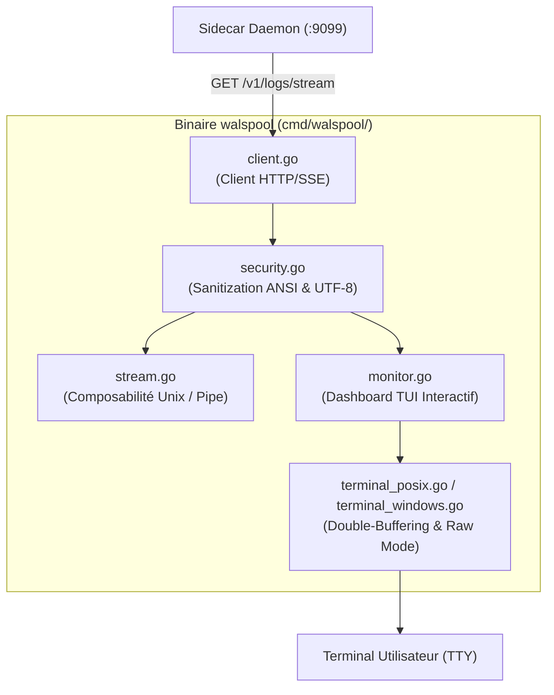

# ADR-002 : CLI Autonome `walspool` avec TUI Pur Go sans Dépendance & Défense contre Injections ANSI

* **Statut :** Accepté  
* **Date :** Octobre 2026  
* **Auteur :** Yohann Hommet & Conseil d'Architecture Walspool  
* **Composant :** Outil CLI (`cmd/walspool/`)  
* **Branche Associée :** `feature/cli-stream-monitor`  

---

## 1. Contexte & Problématique

Dans les architectures de microservices modernes (Kubernetes, Docker Compose, edge nodes), les développeurs et ingénieurs SRE sont confrontés à un dilemme pour observer leurs flux d'événements et de logs :
1. **L'enfer des commandes brutes non filtrées** : `docker compose logs -f` ou `kubectl logs -f` produisent un déluge de texte entrelacé, sans coloration syntaxique, sans filtrage par trace distribuée et sans métriques de santé en direct.
2. **La lourdeur des stacks tierces** : Déployer et configurer une infrastructure complète (Grafana, Loki, Prometheus, Jaeger) juste pour surveiller un environnement local ou une staging représente un gaspillage massif de ressources (plusieurs gigaoctets de RAM, configurations YAML verbeuses).
3. **Le piège des dépendances TUI externes** : Les frameworks TUI populaires en Go (tels que *Bubbletea*, *Lipgloss*, *Tview* ou *Termbox-go*) apportent des dizaines de dépendances externes transitives dans le `go.mod` (par exemple `charmbracelet/bubbletea`, `muesli/termenv`, `mattn/go-runewidth`), ce qui viole frontalement la doctrine intangible de Walspool : **zéro dépendance tierce**.
4. **Le risque de sécurité : Terminal Escape Injection** : Un CLI consommant un flux de logs arbitraire est un vecteur d'attaque critique. Si un payload logué contient des séquences d'échappement ANSI malveillantes (séquences CSI hostiles, réécriture d'écran, exploitation du presse-papier système via la commande OSC 52), un attaquant peut exécuter du code sur la machine de l'opérateur en injectant des commandes shell masquées.

---

## 2. Décision Architecturale

Nous avons décidé de concevoir et d'intégrer dans le projet un binaire CLI autonome nommé `walspool` (`cmd/walspool/`), écrit **exclusivement avec la bibliothèque standard Go**, doté d'un moteur de rendu TUI interactif en double-buffering et d'un module de sanitization de sécurité intraitable.

### 2.1. Les Deux Commandes Clés
1. **`walspool stream` (Composabilité Unix & Filtrage Temps Réel)** :
   - Consomme le flux Server-Sent Events (`GET /v1/logs/stream`) du sidecar.
   - Supporte le filtrage côté client et serveur (`--service`, `--trace`, `--level`, `--filter`).
   - Deux modes de sortie automatiques :
     * **Mode TTY** : Sortie colorée avec badges ANSI de sévérité, horodatage UTC et coloration JSON lisible.
     * **Mode Pipe (non-TTY)** : Détection via `isatty` ; désactivation instantanée des séquences ANSI, émission de lignes brutes ou JSON compact pour traitement via `grep`, `jq`, `awk` ou redirection vers fichier.
   - Respect absolu de la convention Unix `SIGPIPE` : terminaison propre et silencieuse si le consommateur aval se ferme (ex: `walspool stream | head -n 10`).

2. **`walspool monitor` (Tableau de Bord Live SRE 60 fps)** :
   - Bascule le terminal dans l'écran alternatif (*Alternate Screen Buffer* : `\x1b[?1049h`).
   - Affiche en direct les métriques du spooler (taux d'ingestion ev/s, débit disque Ko/s, volume non committé, compteurs de records, statut de synchronisation).
   - Trace une mini-sparkline d'activité en caractères Unicode (` ▂▃▅▆▇`).
   - Affiche la liste dynamique des derniers logs reçus avec sélection et surbrillance.
   - Restaure impeccablement l'écran principal de l'utilisateur à l'extinction (`Ctrl+C` ou touche `q`).

### 2.2. Moteur de Rendu TUI en Double-Buffering Pur Go
- **Zéro Scintillement (Flicker-Free)** : Pour éviter le clignotement insupportable causé par un `clear screen` naïf à chaque frame, le moteur maintient deux tampons d'écran en mémoire (le buffer courant et le buffer précédent).
- **Rendu Différentiel** : Le moteur calcule le delta ligne par ligne et n'émet sur `os.Stdout` que les cellules ayant changé, encapsulées dans un seul appel d'écriture atomique bufferisé (`bufio.Writer`).
- **Support Multi-Plateformes Natif** :
  - **Linux / macOS** : Lecture directe de la taille de fenêtre via `syscall.Syscall(syscall.SYS_IOCTL, ..., syscall.TIOCGWINSZ)`.
  - **Windows** : Détection et activation du mode console virtuel (*Virtual Terminal Processing*) via `syscall.SyscallN(kernel32.NewProc("SetConsoleMode"))`.

### 2.3. Bouclier de Sécurité : Sanitization ANSI & OSC-52
Le composant [`cmd/walspool/security.go`](file:///home/yohann/Labs/walspool/cmd/walspool/security.go) applique un filtre d'hygiène rigoureux sur chaque ligne de texte avant tout affichage :
- **Validation UTF-8 Stricte** : Détection et neutralisation des séquences d'octets invalides ou tronquées via `utf8.ValidString`.
- **Élimination des Caractères de Contrôle Dangereux** : Neutralisation de `BEL` (0x07), `BS` (0x08), `ESC` (0x1B) non autorisés, et des codes de contrôle C0/C1 pouvant altérer l'état du terminal.
- **Filtrage des Commandes OSC (Operating System Command)** : Interdiction absolue des séquences de manipulation du presse-papier système (OSC 52 `\x1b]52;...`) et de redéfinition du titre de fenêtre (OSC 0/2) provenant des payloads applicatifs.
- **Protection contre les Payloads Géants (OOM Shield)** : Troncature automatique des lignes excédant 64 Ko pour prévenir tout déni de service par saturation mémoire dans le terminal.

---

## 3. Options Concurrentes Écartées

1. **Adoption de Bubbletea / Lipgloss / Termbox** :  
   *Raison du rejet :* Introduirait plus de 15 dépendances externes dans `go.mod`, augmentant la surface d'attaque, la taille du binaire et violant la doctrine de pureté du projet.
2. **Intégration d'une Interface Web Embarquée (Web UI / React)** :  
   *Raison du rejet :* Nécessiterait l'embarquement d'assets HTML/JS lourds, un serveur HTTP additionnel, et forcerait le développeur à ouvrir un navigateur distant plutôt que d'opérer directement dans son terminal de développement.
3. **Absence de Sanitization (Confiance aveugle aux logs)** :  
   *Raison du rejet :* Inacceptable pour un outil d'infrastructure destiné à la production. Un log applicatif corrompu ou contenant une trace d'attaque ne doit jamais pouvoir compromettre la session de l'ingénieur qui le consulte.

---

## 4. Conséquences & Bénéfices

* **Binaire Unique Ultra-Léger** : `bin/walspool` pèse environ 15 Mo, compile instantanément en Go pur (`CGO_ENABLED=0`), et s'exécute avec moins de 15 Mo de RAM.
* **Adoption Immédiate (TTFV < 10s)** : N'importe quel développeur peut immédiatement lancer `walspool stream` ou `walspool monitor` sur sa machine sans configuration préalable.
* **Sécurité Certifiée** : Immunité totale contre les attaques par injection de terminal (CSI/OSC 52) validée par des tests unitaires exhaustifs dans `security_test.go`.
* **Philosophie Unix Préservée** : Intégration parfaite dans les pipelines de scripts shell via stdout/stderr et détection de TTY.
