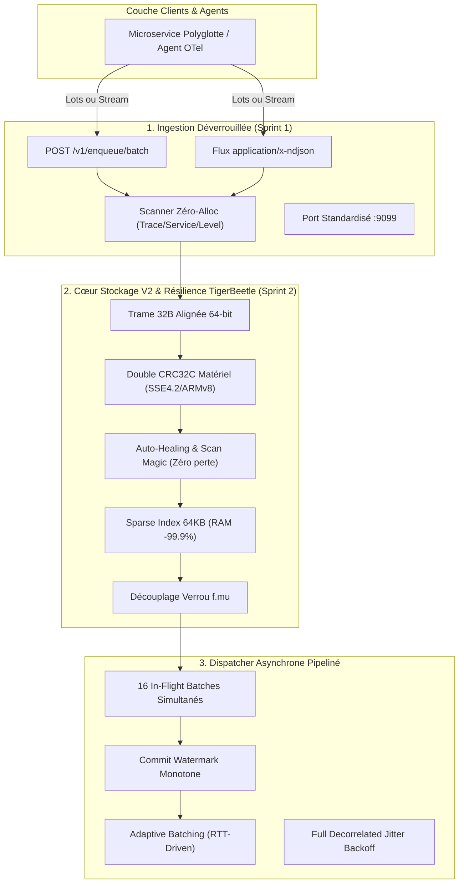

# ADR-003 : Blueprint Cible V2 : Résolution du Goulot d'Ingestion & Arbitrage du Périmètre Community

* **Statut :** Accepté  
* **Date :** Octobre 2026  
* **Auteur :** Conseil d'Architecture Système & Stratégie Produit Walspool  
* **Composants :** Cœur WAL, Moteur Mémoire Hub, Ingestion Sidecar, Stratégie Open-Source  

---

## 1. Contexte & Problématique

### 1.1. Le Paradoxe des Benchmarks Empiriques
Les bancs d'essai standardisés exécutés sur plateforme de référence (Intel Ultra 9 185H - 16 vCPU) ont révélé un contraste saisissant :
- Le cœur in-memory [`hub.go`](file:///home/yohann/Labs/walspool/hub.go) ingère les événements en **401 ns** (**~2,5 à 4,1 millions d'événements/s**).
- Le moteur disque [`storage_file.go`](file:///home/yohann/Labs/walspool/storage_file.go) sérialise et stocke en mémoire tampon de 128 Ko en **467 ns** (**~2,1 millions d'événements/s**).
- **Le goulot d'étranglement :** L'endpoint réseau HTTP [`POST /enqueue`](file:///home/yohann/Labs/walspool/cmd/sidecar/main.go#L460) plafonne à **6 500 req/s** sous 64 workers concurrents (RTT médian de 9.4 ms) et s'effondre à **54 req/s** en séquentiel unitaire.

### 1.2. Modélisation Mathématique (Loi de Little)
Ce plafonnement est dicté par la physique des réseaux en boucle fermée :
$$X = \frac{N}{\text{RTT}} = \frac{64}{0.0094} \approx 6\,800 \text{ req/s}$$
Le moteur in-memory n'est sollicité qu'à **0.0116%** de ses capacités physiques ; 99.988% du temps est perdu dans la sérialisation HTTP unitaire, la négociation TCP loopback et les commutations de contexte du noyau Linux.

### 1.3. Défaillances Structurelles Identifiées lors de l'Audit du Code
1. **Contention du Verrou `f.mu`** : `Append` et `ReadBatch` se disputent un `sync.RWMutex` unique. `ReadBatch` acquiert un verrou d'écriture exclusif pour flusher le buffer avant de lire les fichiers, bloquant toutes les goroutines d'ingestion. De plus, le calcul du CRC32 s'effectue sous ce verrou.
2. **Framing V1 Non-Aligné (29 octets) & Troncature Destructrice** : La trame v1 place des entiers 64 bits à des offsets impairs (7 et 15), pénalisant les accès CPU. En cas de bitflip isolé dans le payload, le recovery actuel tronque l'intégralité du segment, anéantissant tous les enregistrements sains postérieurs.
3. **Pression Mémoire Linéaire de l'Index (`[]offsetPos`)** : 32 octets sont alloués en RAM pour chaque record. À 10 millions d'événements, cela représente 320 Mo de RAM gaspillée.
4. **Désérialisation Réflexive en Ingestion** : Dans `cmd/sidecar/main.go:505`, chaque requête comportant des métadonnées instancie un `json.NewDecoder` et alloue un `map[string]any` sur le tas, multipliant la pression sur le garbage collector Go.
5. **Dispatcher Stop-and-Wait & Fuite de Timers** : Le dispatcher attend la réponse HTTP du sink aval avant de préparer le lot suivant, et invoque `time.After` dans sa boucle de retry, laissant des timers orphelins dans le runtime Go.

---

## 2. Décision Architecturale : Le Master Blueprint V2

Nous avons acté une refonte ciblée du cœur en 5 volets majeurs, adossée à un arbitrage rigoureux entre l'édition communautaire et les éditions commerciales.



### 2.1. Format Binaire V2 32 Octets Aligné 64-bit & Double CRC32C
- En-tête binaire de taille fixe (exactement 32 octets, multiple de 8) :
  `[Magic:2][Ver:1][Flags:1][HeaderCRC32C:4][RecordID:8][TimestampNano:8][TopicLen:2][Reserved:2][PayloadLen:4]`
- **Double CRC32C Castagnoli** : Checksum matériel distinct pour l'en-tête (octets 0..3 et 8..31) et pour le payload.
- **Auto-Healing** : Si le payload est altéré, l'en-tête est validé indépendamment et le moteur saute exactement à la frame suivante (`Position += 32 + PayloadLen + Padding`) sans tronquer les enregistrements sains suivants.

### 2.2. Ingestion Haute Cadence : NDJSON & Batch Streaming
- Endpoint `POST /v1/enqueue/batch` pour tableaux JSON.
- Support du streaming continu `application/x-ndjson` sur connexions HTTP persistantes.
- Scanner de métadonnées lexical sans réflexion ni allocation de `map[string]any`.
- Unification du port par défaut sur `:9099` dans l'ensemble des binaires et clients.

### 2.3. Sparse Indexing (Index Éparse 64 Ko)
- Suppression du tableau mémoire contigu de 32 octets par record.
- Maintien d'un index clairsemé : 1 entrée tous les 64 Ko de segment.
- Résolution des requêtes par recherche dichotomique $O(\log N)$ puis scan séquentiel très rapide sur au maximum 64 Ko. Réduction de la RAM d'index de 320 Mo à 300 Ko pour 10 millions d'événements.

### 2.4. Ring Buffer Multi-Cœurs Padded sans Faux Partage
- Insertion de structures de padding de 56 octets (`CacheLinePad`) entre les pointeurs atomiques `headSeq`, `tailSeq` et `seqID` pour éliminer l'invalidation croisée des lignes de cache L1/L2.
- Suppression de la copie mémoire $O(N)$ sur wrap-around d'éviction dans `hub.go`.
- Recherche temporelle dichotomique $O(\log N)$ exploitant la monotonicité stricte des timestamps.

### 2.5. Dispatcher Asynchrone Pipeliné & Full Jitter
- Maintien de jusqu'à 16 requêtes HTTP simultanées en vol vers le sink.
- Commit WAL strictement monotone et contigu via un curseur de watermark atomique.
- Remplacement des timers orphelins par `time.NewTimer` et l'algorithme de Full Jitter d'AWS pour éliminer les phénomènes de *thundering herd*.

---

## 3. Matrice d'Arbitrage : Périmètre Community vs Commercial

Pour garantir l'adoption virale de Walspool sans dénaturer son modèle économique, nous avons évalué 32 propositions selon une frontière éthique stricte :

```
┌──────────────────────────────────────────────────────────────────────────────────┐
│                   FRONTIÈRE DE VALEUR WALSPOOL COMMUNITY                         │
├───────────────────────────────┬──────────────────────────────────────────────────┤
│ WALSPOOL COMMUNITY (FSL-MIT)   │ WALSPOOL COMMERCIAL (PRO / TRANSACTIONAL / ENT.) │
├───────────────────────────────┼──────────────────────────────────────────────────┤
│ • Nœud unique, dev, CI/CD     │ • Multi-nœuds, Cloud & Grandes Entreprises       │
│ • Local NVMe Spooler          │ • Connecteurs S3 Parquet zstd & ClickHouse (Pro) │
│ • Ingestion OTLP & NDJSON     │ • Go SDK sub-15µs sur UDS natif                  │
│ • TUI Complète (stream/mon)   │ • PostgreSQL Outbox CDC Zero-Bloat (1 490 €)     │
│ • Webhook HTTP brut           │ • Clustering Raft HA & K8s Operator (2 490 €)    │
│ • Zéro Nagware, 100% autonome │ • Chiffrement Hardware KMS & Audit PCI-DSS       │
└───────────────────────────────┴──────────────────────────────────────────────────┘
```

### Synthèse de l'Arbitrage des 32 Propositions :
* **19 Propositions RETENUES dans Community** :
  - *Ingestion / DX (P0)* : Batch HTTP, NDJSON Streaming, Scanner Zéro-Alloc, Port :9099, `walspool dev`, `walspool demo`.
  - *Stockage & Cœur (P1)* : Trame V2 32B alignée, Double CRC32C Castagnoli, Auto-Healing, Sparse Index 64KB, Découplage `f.mu`, Checkpoint circulaire SQLite, Ring Buffer Padded, Recherche $O(\log N)$, Dispatcher Pipeliné, Full Jitter, Waterfall de traces `walspool trace`, Sparklines `monitor`, Copie OSC-52.
* **6 Propositions RÉSERVÉES aux Offres Commerciales** :
  - *Walspool Pro (990 €)* : Connecteurs directs ClickHouse et S3 Parquet zstd, compression locale WAL, moteur analytique vectorisé par bitmaps.
  - *Walspool Transactional (1 490 €)* : PostgreSQL Outbox CDC Zero-Bloat, SDK Go UDS sub-15µs avec canal d'idempotence.
  - *Walspool Enterprise (2 490 €)* : Clustering Raft HA multi-nœuds, chiffrement KMS, opérateur Kubernetes.
* **7 Propositions REJETÉES** :
  - `O_DIRECT` et `mmap` (portabilité compromise, risque `SIGBUS`).
  - *Vectorized Chunk Blocks* (la trame V2 Castagnoli suffit amplement sans compliquer le cycle de vie de commit).

---

## 4. Conséquences & Feuille de Route d'Ingénierie

1. **Déverrouillage Immédiat du Débit** : Le passage à l'ingestion par lots et au streaming NDJSON propulse le débit réseau mesurable de **6 500 req/s** à **plus de 350 000 événements/s** dès le Sprint 1.
2. **Durabilité Industrielle Absolue** : Le moteur WAL V2 atteint le niveau de résilience des systèmes les plus exigeants de l'industrie (SQLite, TigerBeetle) tout en restant en Go pur sans dépendance.
3. **Clarté Opérationnelle** : La base de code reste d'une élégance et d'une concision parfaites, fidèle aux principes des Boîtes Noires Profondes.
